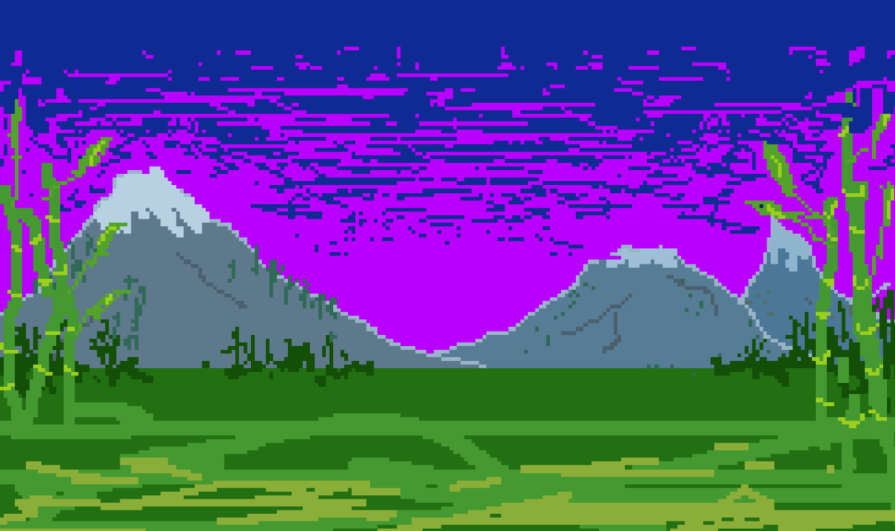

# My version for Astra. Happy Birthday, daughter! <3



🐼 What's new in this fork
- Dancing panda (Kita) — 4 sprite frames, animation triggers on each string strum (one press = next frame).
- Forest background — bamboo, mountains, and grass overlay (`BG_FOREST`, 240×144). Transparent pixels (sky) are skipped.
- Gradient sky — smooth blend from a light top color to the current chord color.
- Chord-reactive background colors — 11 bright pastel shades (`CHORD_BG`). Transitions “through white” (snap to white → fade to chord color) to avoid muddy mixing.
- Stars in the sky — 32 randomly placed stars (deterministic PRNG). Each string lights two stars; stars fade out slowly.
- Layered rendering — correct draw order: sky gradient → stars → mountains/bamboo/grass → panda → pads.
- Panda lowered — `bear_y = 35` (was 40/45).
- `bear_beat counter` — increments only on actual string presses.
- `bg_counter reset` — on chord change, so the color transition starts immediately.

🛠 Technical notes

- `BG_TRANSPARENT = 0xB81F` — “magic pink” (transparent color in the sprite, different fot BG and Kita).
- `BG_SKY_TOP` — top sky color (adjustable).
- `BG_TINT` — how much chord color tints the bamboo overlay (0..16).
- `BEAR_FRAME_COUNT = 4`, `BEAR_W = 64`, `BEAR_H = 64`.
- `N_STARS = 32`, `star_map[]` — string-to-star mapping (xorshift32 shuffle).
- `draw_sky_gradient()` + `draw_overlay()` — split background into layers.
- `bg_fade_step()` — smooth transition with “snap to white” on chord change.

📋 Files changed / added

- `firmware/src/app/ui.c` — main logic (panda, stars, background, chord colors).
- `firmware/src/app/bg_forest.c` (or .h) — `BG_FOREST[240*144]` array (RGB565, Piskel export).
- `firmware/src/app/bear_sprites.c` — four panda frames (already present).
- `host/omni_host.c and firmware/src/main.c` — added `#include` for `bg_forest.c`.

🎨 Tweakable settings

- `BG_SKY_TOP` — sky color 
- `BG_TINT` — bamboo tint strength (currently 2; try 3..5).
- `CHORD_BG[]` — chord color palette (11 colors).
- `bear_y` — panda position (currently 35).

---------------------------------------------------------------------------
# FoMni for the M-VAVE FM-1

FoMni turns the M-VAVE FM-1 into a chord harp inspired by the Suzuki Omnichord. The 16 white
keys are the strum plate: run a finger across them and they ring out the chord. The 11 black keys
are the chord buttons. Behind them sit an organ-like chord with its bass, and the OM-84's ten
rhythms, which can play the bass and chord in time (auto bass sync).

It is meant to be simple: one screen, four knobs a page, no patterns to program.

[](https://www.youtube.com/watch?v=pahaM6nzucE)

  

- **Try it in your browser** (no FM-1 needed): <https://charlesvestal.github.io/fm1-fomni/emu/>
- **Install it** (Chrome or Edge, with the FM-1 plugged in): <https://charlesvestal.github.io/fm1-fomni/install/>
- **Download the firmware file**: [releases](https://github.com/charlesvestal/fm1-fomni/releases)

Installing is at your own risk, though it's hard to get stuck: the web installer can put M-VAVE's
firmware back, and an FM-1 that keeps crashing starts in a safe mode.

## Playing

| | |
|---|---|
| White keys | The strum plate. Each key plucks one string of the chord. As on the Omnichord, each group of three keys is root, third and fifth, folded into an F#–F window, five groups up, with a root on top. |
| Black keys | Chord buttons (F C G, Dm Am, Em G7 E7, D7 Bb, A7 by default). Hold **ENV** for the minor, **LFO** for the 7th, both for the m7, the Omnichord's three rows. |
| PLAY | The rhythm, on and off. |
| REC | SYNC START: the rhythm waits for your first chord. |
| ARP | CHORD HOLD: the chord keeps playing after you let go (press the same button again to stop it). |
| OCT− / OCT+ | Move the strum plate an octave. |
| SELECT | Tempo. |
| ALGORITHM | Rhythm. |
| PRESETS | Transpose (−6 to +6). |
| KNOB 1–4 | The four values on the screen (see the pages below). |
| SAVE | Saves. FoMni also saves by itself a few seconds after a change, once it's quiet. |

### The pages

Each page puts four values on KNOB 1–4. EDIT steps through the pages.

- **HOME: Play.** Voice 1, Voice 2, Sustain, Chord level.
- **SEQ: Rhythm.** Rhythm, Tempo, Drums level, Auto bass (on: the bass and chord play in time with the rhythm).
- **FX: Sound.** Reverb (the strings' send), Space (the plate's size), Width, Chord rev (the chord and bass's send). The drums stay dry.
- **SEL: Chords.** Change the chord on any black key: press the key, then turn Root (KNOB 1) and Type (KNOB 2). KNOB 3 and 4 are Transpose and Octave.
- **GLO: Setup.** Tune, MIDI out, Lights (On: the key lights, and the unlit buttons glow dimly so they can be read; Keys: the key lights only; Off).

**Voice 1** is the Omnichord's shimmering harp, and **Voice 2** is its plain one. Mix them, and
set how long the strings ring with **Sustain**.

### MIDI

MIDI comes in over USB and the TRS jack (the FM-1's jack is an input), and goes out over USB.

- **In, channel 1:** notes pluck the nearest string.
- **In, channel 2:** play a chord on a keyboard and it becomes the chord, as if you'd pressed a black key.
- **In, clock:** the rhythm follows MIDI clock and start / stop; the screen shows EXT for the tempo.
- **Out** (on by default, Setup page): the strings on channel 1, the chord on 2, the bass on 3, the drums
  on 10, and clock with start / stop when the rhythm runs on its own tempo.

## Building and testing

The toolchain is the same as X0X's (see [BUILDING.md](BUILDING.md)):

```
tests/run_tests.sh      # the instrument, the platform pieces, the app in a simulator
./build.sh              # build/omni.fwsc
python3 tools/fm1_install.py build/omni.fwsc     # install it over USB
```

`build/host/omni_host SCRIPT OUTDIR` runs the whole app on a computer from a script
(`tests/scenarios/*.omni`), with audio and screenshots coming out. `web/emu/build.sh` builds the
same code for the browser.

## Credits

The rhythms, waves, drum sounds and envelope shapes come from
[Chordian](https://github.com/Jan125/pb.chordian), Jan125's OM-84 emulator (CC0). The platform
(hardware layer, USB, update loader, storage, installer) is
[Felucca](https://github.com/hugelton/Felucca)'s by Leo Kuroshita (Hügelton Instruments), by way of
[X0X](https://github.com/charlesvestal/fm1-x0x). GPL-3.0-only; see [LICENSING.md](LICENSING.md).

Omnichord is a trademark of Suzuki. FoMni isn't affiliated with or endorsed by Suzuki, M-VAVE or
Hügelton Instruments.
